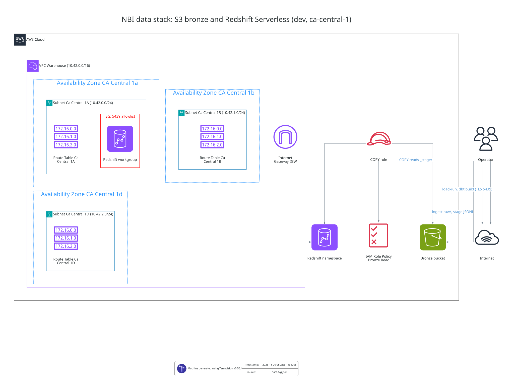
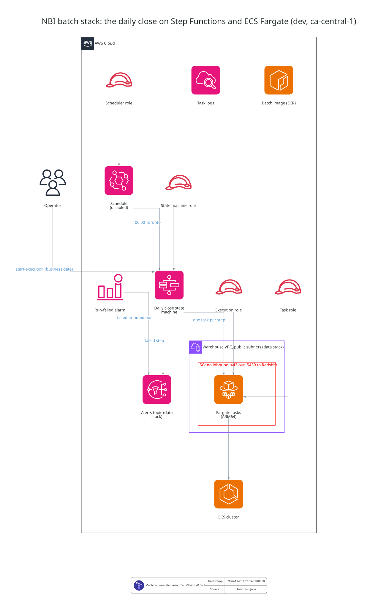
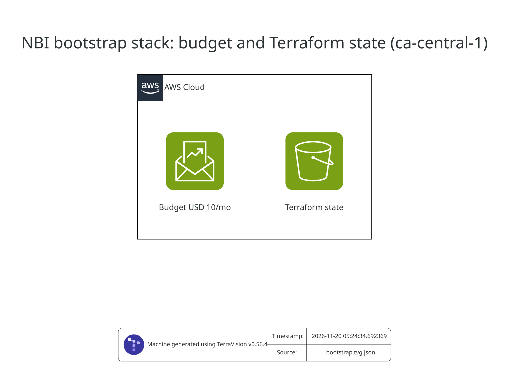

# Cloud warehouse: S3 bronze and Redshift Serverless

| | |
|---|---|
| Status | Phase 4F: loading and dbt (4F-a), incremental models (4F-b), and reconciliation and publication (4F-c) on Redshift. The cloud run (Step Functions and ECS Fargate, [ADR 010](../adr/010-cloud-batch-runtime.md)) is written in 4G and not yet applied |
| Decisions | [ADR 005](../adr/005-local-postgres-cloud-redshift.md) (local Postgres, cloud Redshift); owner decisions 2026-11-20: Step Functions and Fargate for the cloud batch; Redshift controls by grants, the application, and dbt tests |
| Infrastructure | [Terraform data stack](../../infrastructure/terraform/data/README.md) |
| Facts | [sources.md](../sources.md): the Redshift and S3 rows dated 2026-11-20 |

The same pipeline code runs against both warehouses. `--warehouse postgres` (the default) uses the local stack: SeaweedFS and Postgres. `--warehouse redshift` uses the S3 bronze bucket and Redshift Serverless.

## Architecture

What the three Terraform stacks deploy, drawn by [TerraVision](https://github.com/patrickchugh/terravision) 0.56.4 from `terraform plan`. The whole platform in one picture, with a walk-through of a run, is in the [README](../../README.md#architecture-on-aws).







**What the diagrams leave out:**
- **Resources TerraVision has no icon for:** the usage limits (4 RPU-hours a day, deactivate; 60 a month, emit-metric) and the buckets' ownership controls. They would be blank boxes. The batch stack's role policies are drawn as their roles, and its security group rules are summarised in the group's label.
- **Edges TerraVision won't draw:** the tasks pull their image from ECR and write to the task log group. TerraVision hides edges into those two nodes, even when an annotation asks for them.
- **Edges between stacks:** the batch tasks connect to the Redshift workgroup (port 5439, inside the VPC) and read and write the bronze bucket. Both are in the data stack. The batch diagram shows only the VPC and the alerts topic it looks up from there.
- **Things outside the stacks:** the Redshift-managed admin secret, and Looker Studio.

**How they're made.** `make diagrams` (`scripts/draw_architecture.sh`) needs `aws login` and the data stack applied, because the batch stack looks up the data stack's resources. It works on copies of the stacks in a temporary directory:
1. TerraVision plans them against empty local state, so the stacks' S3 state is never read and nothing is applied. The required variables get placeholder values, which change no resource's shape.
2. `scripts/terravision_prune.py` corrects TerraVision's artifacts in three steps:
   - **Drop:** the three duplicate copies of the workgroup and its security group, a "shared services" IAM group that no stack declares, and the blank nodes.
   - **Rewire:** the batch stack's edges, so the Fargate tasks sit in their security group inside the VPC, and the schedule, roles, and alarm point at what they act on.
   - **Add:** the edges a plan can't show (the COPY role reading the bronze bucket, and the operator).

   If TerraVision's output changes shape, the script fails.
3. TerraVision draws the result with the labels in `aws/*.terravision.yml`.

The route-table icon shows "172.16.x", which is part of TerraVision's icon, not an address in this VPC. Run `make diagrams` again whenever a stack changes.

## Flow

```
ingest ─► s3://northstar-bronze-…/raw/…   content-addressed, put-if-absent (bronze)
load-run ─► s3://…/_stage/<schema>.<table>/<sha256>.jsonl ─► COPY ─► temp table
          ─► conflict check ─► INSERT … WHERE NOT EXISTS ─► raw_dev, ledger_dev
dbt build (target redshift) ─► dbt_dataset (silver and gold; incremental, see incremental-models.md)
```

- **Ingest is unchanged.** It writes the same content-addressed objects to S3. AWS S3 refuses an overwrite just as SeaweedFS does: re-ingesting wrote 0 of 929 objects again.
- **Loading has the same contract on both warehouses** (`insert_new`): new keys are inserted, a replay inserts nothing, and a stored row with different content is refused (`LoadConflictError`).
  - Postgres uses `COPY FROM STDIN` and `ON CONFLICT`.
  - Redshift has neither, so the rows are staged as JSON Lines under `_stage/`, which is content-addressed so a replay reuses the file. They are then copied into a temp table, checked null-safely (Redshift has no `IS DISTINCT FROM`), and inserted where the key is new.
  - Journal lines are posted by Python and loaded the same way.
- **No passwords.** The pipeline and dbt connect with temporary IAM credentials (`redshift-serverless get-credentials`), as the caller's IAM database user. Only `redshift-bootstrap` uses the admin, whose password Redshift keeps in Secrets Manager.

## Controls on Redshift

Redshift has no triggers and no CHECK constraints, and doesn't enforce unique keys. The owner decided on 2026-11-20 that the controls Postgres enforces in the database are enforced on Redshift as follows:

| Control | Postgres | Redshift |
|---|---|---|
| Append-only raw, ledger, and recon tables (W2.4, W3.3) | triggers refuse UPDATE, DELETE, TRUNCATE | the admin owns the tables. The pipeline's role (`nbi_pipeline`) holds only USAGE, SELECT, and INSERT, so UPDATE, DELETE, TRUNCATE, and LOCK are refused. Proven as the pipeline user by `make test-redshift` |
| Lifecycle rules on transitions (FR-M2-05, FR-M2-06) | CHECK and UNIQUE constraints | the domain's `check()` before every write, plus `assert_exception_transitions_follow_the_lifecycle` (dbt, both warehouses), which returns any stored row that breaks a rule |
| Journal line constraints (ADR 002) | CHECK and UNIQUE constraints | `insert_new`, plus `assert_journal_lines_meet_ledger_constraints` (dbt, both warehouses) |
| One manual change at a time per exception | `SELECT … FOR UPDATE` | `LOCK` on an empty `lifecycle_lock` table. LOCK needs UPDATE, which the pipeline holds on that table only |
| Append-only published snapshots (W3.3, ADR 006) | triggers refuse UPDATE, DELETE, TRUNCATE | the admin creates the published tables (`redshift-bootstrap --published-schema … --dbt-schema …`, after the first dbt build, because the copies take the marts' columns); the pipeline only inserts. Proven by `make test-redshift` |
| Snapshot version rules: version 1 has no restatement reason, later versions need one; three statuses | CHECK constraints | `record_version` and `log_status` refuse a breaking row before writing, on both warehouses (tested on Postgres, where the database would otherwise refuse it first) |

`make test-redshift` also inserts one row per broken rule on Redshift, where nothing refuses them, and checks that each dbt test returns exactly those rows: 10 transitions and 5 journal lines. Removing a rule from either test makes it fail.

## dbt on both warehouses

`profiles.yml` has a `redshift` target (`NBI_DBT_TARGET=redshift`) next to `local`. The differences are handled by the macros in `warehouse/dbt/macros/dialect.sql`:

| Need | Macro | Postgres | Redshift |
|---|---|---|---|
| a field in a JSON payload | `json_text`, `json_value` | `payload -> 'a' ->> 'b'` | SUPER path `payload."a"."b"` |
| an array of JSON strings, one row each | `json_array_texts` | `jsonb_array_elements_text` | PartiQL in `FROM` |
| strings | `string_type()` | `text` | `varchar(4096)` (`text` would be varchar(256)) |
| `a is distinct from b` | `distinct_from` | portable null-safe form | same |

- **No bare `numeric`.** Redshift reads `numeric` as numeric(18, 0) and rounds the decimals away; porting found KPI-01's daily totals rounded to whole dollars that way, and they're fixed. Every cast and contract type states its precision.
- **The guard.** `tests/unit/test_dbt_portability.py` fails CI on bare `numeric`, `::text`, jsonb operators and functions, `IS DISTINCT FROM`, `FILTER`, `DISTINCT ON`, `LATERAL`, `generate_series`, and unquoted comma types in YAML. CI never runs Redshift, so this guard keeps it in reach.
- **Parsing both targets.** `make dbt-parse` parses both targets.
- **Incremental models.** The incremental models and their `rebuild` strategy run unchanged on both warehouses ([incremental models](incremental-models.md)). `tests/redshift/test_redshift_incremental.py` runs the late-data scenario live.

## Reconciliation and publication

`reconcile` and `publish` take `--warehouse redshift` like every other command. Two things had to change so that both warehouses give the same answer:

- **Order without a collation.** Postgres here sorts text by `en_US.utf8`, and Redshift sorts it differently. Snapshot content hashes were computed over rows sorted by SQL, and matching takes the first of several candidate records, so either could depend on the warehouse. Both now sort rows in Python (`infrastructure/ordering.py`): every column ascending, nulls last, text by code point. All 237 snapshot versions stored locally on 2026-11-20 hash the same as before, so nothing was restated by the change, and reconciliation of the dev dataset still finds the same 76 exceptions, an exact match with the defect manifest.
- **The publication store.** `jsonb` becomes SUPER (written with `json_parse`, read back as JSON text and parsed). There is no `add column if not exists`, so the catalog is checked first.

## Parity with Postgres

`make compare-warehouses` compares every model in `dbt_dataset` between the two warehouses, row for row. It leaves out only the lineage columns, which identify a run rather than the data.

| Run | Result |
|---|---|
| Commit `fee1f1a`, 2026-11-20. The seed-42 dev dataset (`make simulate`) plus the late-deposit fixture, loaded into both warehouses. `make dbt-build-dataset` and `make dbt-build-redshift`: 241 of 241 pass on each. Then `make compare-warehouses` | **41 of 49 models identical**. The other 8 are the reconciliation models (`stg_recon__*`, `fct_reconciliation_exceptions`, and the KPI-02, -03/-04, and -05 marts), which are empty on Redshift until reconciliation runs there (4F-c) |

**The parity run (4F-c gate).** `make parity` runs the same pipeline from nothing on each warehouse, in dedicated schemas: the seed-42 dev dataset, then the late deposit, each through ingest, load, `dbt build`, reconcile, the controls marts, and both publication streams (`scripts/parity.sh`). No exception is changed by hand, so both see the same inputs. Then every table in the dbt, recon, and two published schemas is compared. It leaves out the columns that record when or by which run something happened: run IDs, `created_at`, `changed_at`, `opened_at`, `resolved_at`, `published_at`, `superseded_at`, and `code_version`. Every content hash is compared.

**Known differences that don't change results:**
- **Division precision.** Redshift sizes a division's result from its operands and caps the precision at 38. `numeric(38, 0) / integer` keeps only 4 decimal places there. 4F-a's comparison didn't show this: the rate marts were empty on Redshift until reconciliation ran there. The 4F-c parity run did show it, in the count ratios of KPI-02 and KPI-05. Count ratios now use `count_ratio_half_even`, which rounds half-even in integer arithmetic, exact on any warehouse. The portability guard refuses a precision-38 integer division, even inside a macro argument. Ratios of two amounts (`numeric(18, 2)`) keep 19 decimal places on Redshift.
- **`_ingested_at` precision.** Redshift stores whole seconds. This is lineage only.
- **SUPER values.** They come back as JSON text, not parsed JSON. The comparison normalises the form, never the value.

## Commands

| Target | What it does |
|---|---|
| `make redshift-bootstrap` | as the admin, creates the dev schemas' append-only tables and grants your IAM database user the pipeline role |
| `northstar --warehouse redshift ingest …` / `load-run …` | ingest to S3 bronze; load into Redshift |
| `make dbt-build-redshift` | `dbt build` on Redshift into `dbt_dataset` |
| `make compare-warehouses` | Postgres vs Redshift, every model |
| `make test-redshift` | loading, append-only (raw, ledger, recon, published), lock, dbt-check controls, and the incremental late-data scenario, live (minutes of compute) |
| `make parity` | the same pipeline from nothing on both warehouses, then every table compared (needs `make up` too; minutes of compute) |

Each needs `aws login`. The endpoint, bucket, and secret ARN contain the account ID, so they are read from `terraform output` at run time (`scripts/redshift_env.py`) and never committed.
