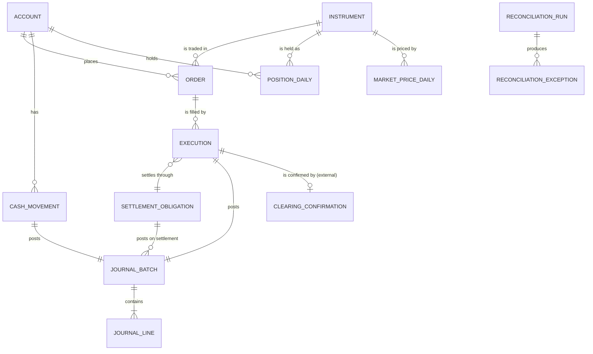
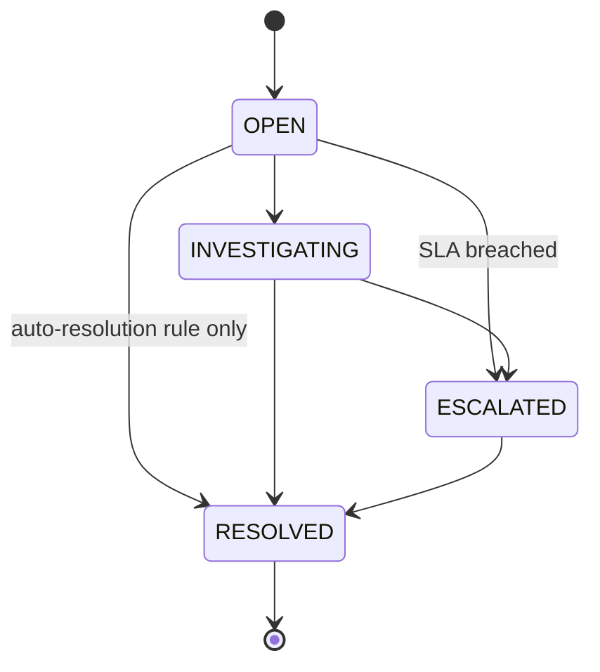

# Canonical domain model

| | |
|---|---|
| Status | Approved design (Phase 0, 2026-11-18). **Partly implemented (Sprint 1, Phase 2):** every event type in §4.2, every v1 posting rule in §9.2 (deposits, withdrawals, FX, trades with clearing fees, settlements, margin interest), the XTSE/XNYS/XCBO calendars, positions and the stock record, and INV-01 and INV-03 to INV-06. Reconciliation (§7) is designed and has its ground truth (the defect manifest), but is not built. Open questions in §10 are resolved in the phases listed there. |
| Last updated | 2026-11-18 |
| Decisions | [ADR 002](../adr/002-ledger-system-of-record.md), [ADR 004](../adr/004-fixed-precision-money.md), [ADR 006](../adr/006-bitemporal-records-and-restatements.md) |

All five modules use the definitions in this document. If code and this document disagree, one of them is wrong: fix whichever it is in the same change.

Items marked † are deliberate simplifications of real brokerage practice. They are listed so reviewers can see what the simulation does *not* model.

---

## 1. Scope of the model

The model covers one simulated broker with:

- client accounts in CAD and USD, of types `CASH` and `MARGIN`
- instruments: Canadian and US-listed equities, ETFs, and listed equity options (long only in the first release; no short selling)
- money movements: deposits, withdrawals, CAD↔USD conversions, commissions, clearing fees, and margin interest
- trade lifecycle: order → executions → trade-date obligation → settlement
- independently simulated external parties: a clearing firm, a custodian or depository, and a bank

## 2. Conceptual model

## 3. Canonical entities

The target warehouse models are listed below. Grain is what one row represents. Every model also carries the audit columns in §4.3.

| Model | Grain | Primary key | Purpose | Owner |
|---|---|---|---|---|
| `dim_account` | one account version (SCD2) | `account_sk` (natural `account_id` + `valid_from`) | type, base currency, margin eligibility, open/close dates | M1 |
| `dim_instrument` | one instrument version (SCD2) | `instrument_sk` | symbol, listing exchange, currency, asset class, issuer, option terms (underlying, strike, expiry, call/put, exercise style, multiplier) | M1 |
| `dim_calendar` | one calendar date × market | `(calendar_date, market)` | business day flag, holiday name, next/previous business day | M1 |
| `fct_orders` | one order | `order_id` | side, quantity, order type, limit price, status | M1 |
| `fct_executions` | one execution (fill) | `execution_id` | quantity, price, commission, trade date, settlement date | M1 |
| `fct_journal_lines` | one journal line | `journal_line_id` | GL account, debit/credit, amount, currency, batch, posting date, source event | M2 |
| `fct_settlements` | one settlement obligation | `settlement_id` | expected amount and quantity, contractual date, actual date, status | M1 |
| `fct_cash_movements` | one deposit, withdrawal, or conversion | `cash_movement_id` | direction, amount, currency, value date | M1 |
| `fct_positions_daily` | account × instrument × business date | `(account_id, instrument_id, business_date)` | trade-date and settlement-date quantity, average cost, market value | M1 |
| `fct_market_prices_daily` | instrument × business date | `(instrument_id, business_date)` | close price, price timestamp, source, staleness flag | M1 |
| `fct_fx_rates_daily` | currency pair × rate date | `(base_ccy, quote_ccy, rate_date)` | rate, source series, publication date | M1 |
| `fct_margin_exposure_daily` | account × business date × policy version | `(account_id, business_date, policy_version)` | equity, loan balance, requirement, excess/deficit | M3 |
| `fct_reconciliation_exceptions` | one exception | `exception_id` | type, severity, impact, status, links to evidence | M2 |
| `fct_portfolio_risk_daily` | account × business date × model version | `(account_id, business_date, model_version)` | VaR, ES, stress losses, concentration | M3 |
| `fct_liquidity_forecasts` | forecast run × currency × horizon × scenario × quantile | `(forecast_run_id, currency, horizon, scenario, quantile)` | forecast value, known vs. forecast components | M4 |
| `fct_product_profitability` | product × month × reporting currency × snapshot version | `(product, month, reporting_ccy, snapshot_version)` | revenue, direct costs, contribution margin | M5 |

Surrogate keys (`*_sk`) are dbt-generated hashes of the natural key plus the version column. Natural IDs come from the source systems and never change.

## 4. Identifiers, event envelope, audit columns

### 4.1 Identifiers

- **Source entities** get prefixed, deterministic IDs from the simulator, built from `(seed, entity type, sequence number)`:
  `acc_`, `ins_`, `ord_`, `exe_`, `cm_` (cash movement), `fxc_` (FX conversion), `stl_` (settlement, including an exercise's), `div_` (dividend), `oex_` (option exercise), `evt_` (event).
  The same seed produces the same IDs.
- **Derived records** (journal batches and lines, exceptions) get UUIDv5 IDs computed from their causal inputs. A journal line uses `(source_event_id, posting_rule_id, posting_rule_version, line_number)`. Re-posting the same event under the same rule therefore produces the same IDs, which makes posting idempotent.
- **External records** (clearing, custody, bank) carry their own external reference IDs plus, where a real counterparty would provide one, the broker's reference. An injected defect may corrupt or drop that reference, which is why composite matching exists.

### 4.2 Event envelope

Every source event has this envelope. Payload fields depend on `event_type`. The JSON Schemas are generated from the pydantic models in `northstar.domain.events` into `contracts/events/<type>.v<N>.schema.json` (`scripts/export_event_schemas.py`), and a contract test fails if they drift. Implemented: `account_created`, `instrument_listed`, `cash_deposited`, `cash_withdrawn`, `fx_converted`, `order_placed`, `order_cancelled`, `trade_executed` (**v2**: adds an optional `clearing_fee`; v1 events stay valid but may not carry a fee), `trade_settled`, `price_updated`, `margin_interest_accrued`, `account_updated`, `fx_rate_published`, `dividend_declared`, `dividend_paid`, `option_exercised`, `exercise_settled`, and `option_expired`. Each type keeps its own `schema_version`.

| Field | Type | Meaning |
|---|---|---|
| `event_id` | string | globally unique, deterministic |
| `event_type` | string | e.g., `trade_executed` |
| `schema_version` | integer | version of the payload schema |
| `source_system` | string | e.g., `brokerage_simulator`, `clearing_simulator` |
| `event_timestamp` | RFC 3339 UTC | when the fact occurred |
| `recorded_at` | RFC 3339 UTC | when the source system recorded it (≥ `event_timestamp`; used to simulate late arrival) |
| `correlation_id` | string | groups an event chain (e.g., the `order_id`) |
| `causation_id` | string, nullable | the `event_id` that caused this event |
| `payload` | object | type-specific fields |

**Monetary and quantity values are serialized as decimal strings** (`"250.00"`), never JSON numbers, so that no precision is lost.

The event types are `account_created`, `account_updated`, `instrument_listed`, `cash_deposited`, `cash_withdrawn`, `fx_converted`, `fx_rate_published`, `order_placed`, `order_cancelled`, `trade_executed`, `trade_settled`, `price_updated`, `margin_interest_accrued`, `dividend_declared`, `dividend_paid`, `option_exercised`, `exercise_settled`, `option_expired`. More are added only when a module needs them, each with its own schema. `dividend_declared` records an issuer's cash dividend (rate in whole cents; ex-date = record date under T+1), and `dividend_paid` its payment on the pay date to every account holding settled shares at the end of the record date, cash basis ([ADR 013](../adr/013-corporate-events.md)). `option_exercised` records a long option exercised early or automatically at expiry: the contracts leave the account, and the underlying is bought (a call) or sold (a put) at the strike, posted like a trade with no fee. `exercise_settled` delivers it the next business day, and `option_expired` records an option that lapsed, with why (`OUT_OF_THE_MONEY` or `NOT_EXERCISABLE`). `account_updated` carries an account's full new state (type, trading status, reason) and drives the SCD2 history of `dim_account` (FR-M1-05).

**Schema evolution.** Additive optional fields bump `schema_version` and remain backward compatible. Any breaking change gets a new `event_type` version and parallel support during migration. Consumers reject unknown major versions to quarantine rather than guessing.

### 4.3 Audit columns (every warehouse model)

`_source_event_id` (where applicable), `_ingestion_run_id`, `_ingested_at`, `_dbt_invocation_id`, `_schema_version`.

## 5. Time semantics

| Concept | Rule (v1) |
|---|---|
| Storage | All timestamps are timezone-aware UTC. |
| Business timezone | `America/Toronto`. |
| `business_date` | The calendar date of `event_timestamp` in `America/Toronto`. |
| Trading events | Executions must fall on a trading day of the instrument's market. Otherwise they are quarantined as a business-rule failure. |
| Ledger `posting_date` | `business_date` if it is a business day on the **ledger calendar**, otherwise the next one (e.g., a Saturday deposit posts on Monday). The ledger calendar is the XTSE CAD settlement calendar, so a deposit on Remembrance Day posts on the next day. |
| Settlement date | Trade date + N business days on the instrument market's settlement calendar (`northstar.domain.settlement.settlement_date`). Trading days and settlement days are different sets: the TSX trades but CAD securities do not settle on Remembrance Day and on the National Day for Truth and Reconciliation. N comes from `settlement_rules` config with **effective dates**. Canadian equities are T+1 for trade dates on or after 2024-05-27 (verified; `config/brokerage/settlement_rules.yaml`). The US moved on 2024-05-28. Earlier T+2 trade dates have no cycle in the policy, because that fact is not yet verified, so they raise `PolicyNotFoundError` ([sources](../sources.md)). The options cycle is configured per market and must be verified before use. |
| Daily close | Business date D is processed by the batch run that starts after D ends. The run's snapshot for D is `DRAFT` until controls pass, then `PUBLISHED` (§7.4). |
| Late-arriving record | A record whose `business_date` is D but is ingested after D's snapshot was published. It is handled under [ADR 006](../adr/006-bitemporal-records-and-restatements.md): it never edits the published version, and it produces a new snapshot version with a restatement reason. |
| Account history | SCD2 with `valid_from` (inclusive) and `valid_to` (exclusive, null = current). |

## 6. Money, currency, FX

- **Representation** ([ADR 004](../adr/004-fixed-precision-money.md)): Python `Decimal` with an explicit currency, and SQL `numeric`. The precisions are fixed in ADR 004.
- **Currencies:** CAD (reporting currency) and USD. Every amount column has an adjacent currency column. No amount column is implicitly CAD.
- **Original vs. reporting:** journal lines are booked in the original currency. Translation to CAD happens at reporting time in marts, and both values are kept.
- **FX reference rate:** the target source is the Bank of Canada daily exchange rate (Valet series `FXUSDCAD`). These rates are published only on Bank of Canada business days and are indicative, not transactional ([sources](../sources.md)). **Current implementation (owner decision, 2026-11-19):** the simulator's synthetic USD/CAD path, published daily as `fx_rate_published`. Client conversions and CAD translation use the same published rates. Bank of Canada ingestion is deferred to a later phase.
- **Missing rate on a business date** (e.g., a US trading day that is a Canadian holiday): the versioned `fx_rate_fallback` policy (v1: use the most recent prior published rate) applies. The output row records both `fx_rate_date` and `fx_policy_version`. Having no prior rate at all is an error.
- **Client conversion rate (simulation):** reference rate ± a configured spread. The spread is FX revenue (see the open question in §10 on how it is recognized).

## 7. Reconciliation exceptions

### 7.1 Reconciliations

| Reconciliation | Internal side | External side | Match keys (stage order) |
|---|---|---|---|
| Executions | `fct_executions` | clearing confirmations | `execution_id` → (account, instrument, side, trade date, quantity, price) → tolerance on price |
| Cash | GL cash accounts | bank statements | statement reference → (value date, amount, currency) |
| Settlements | `fct_settlements` | settlement confirmations | `settlement_id` → (account, instrument, settlement date, quantity) |
| Positions | settlement-date positions | custody snapshots | (account, instrument, date) |
| Fees | commission and fee lines | external fee records | `execution_id` → (account, trade date, amount) |
| FX | client conversions (`fct_cash_movements`) | FX confirmations | `fx_conversion_id` → (account, trade date, sell and buy amounts) |
| Prices | daily closes (`price_updated`) | the vendor price feed | (instrument, price date) |

FX and prices were added in Phase 4 (owner decision, 2026-11-20). The defect manifest (FR-SIM-03) injects wrong FX conversions and stale vendor prices, and reconciliation must detect both. A delayed settlement moves both its confirmation and its bank line. It is one `SETTLEMENT_LATE` exception: the bank line's later value date is an explained timing difference, not a `CASH_BREAK`.

### 7.2 Exception types

`MISSING_EXTERNAL`, `MISSING_INTERNAL`, `DUPLICATE_EXTERNAL`, `QUANTITY_MISMATCH`, `PRICE_MISMATCH`, `FEE_MISMATCH`, `FX_MISMATCH`, `SETTLEMENT_LATE`, `SETTLEMENT_AMOUNT_MISMATCH`, `POSITION_MISMATCH`, `CASH_BREAK`, `STALE_PRICE` (the vendor repeated an earlier close for a day its market traded; added in Phase 4). They are defined in `northstar.domain.reconciliation.ExceptionType`. Matching and classification are in `northstar.domain.matching` and `northstar.domain.reconciliation` ([reconciliation](reconciliation.md)).

### 7.3 Severity

Thresholds live in `config/reconciliation/policy.yaml` (version 2026.1, illustrative; confirmed by the owner on 2026-11-20): CRITICAL ≥ CAD 10,000, HIGH ≥ CAD 1,000, MEDIUM ≥ CAD 100. The SLAs are 1, 2, 5, and 10 business days. Tolerances are exact for IDs, quantities, and amounts, and ±0.0001 per unit for prices. `northstar.domain.reconciliation.ReconciliationPolicy.severity_of` applies the rule below.

| Severity | Rule | Blocks publication |
|---|---|---|
| `CRITICAL` | any `CASH_BREAK`, `MISSING_INTERNAL`, or `POSITION_MISMATCH`; or impact ≥ critical threshold | yes |
| `HIGH` | impact ≥ high threshold | yes |
| `MEDIUM` | impact ≥ medium threshold, or `SETTLEMENT_LATE` | no |
| `LOW` | below thresholds | no |

### 7.4 Lifecycle

- Every transition is an append-only audit record: `exception_id`, `from_status`, `to_status`, `actor` (user or `rule:<id>@<version>`), `reason`, `timestamp`. Implemented in `northstar.domain.lifecycle` and `recon.exception_transitions` ([reconciliation](reconciliation.md#lifecycle-and-audit-trail-fr-m2-05-fr-m2-06)).
- The resolution types are `AUTO_RULE`, `MANUAL_OVERRIDE`, and `SOURCE_CORRECTED` (a corrected record arrived and a rematch succeeded).
- `RESOLVED` is terminal. If the same break recurs, it becomes a new exception linked to the earlier one.
- **Publication gate:** a snapshot moves `DRAFT → PUBLISHED` only when KPI-01 = 0 and no blocking (`CRITICAL`/`HIGH`) exception for that business date is unresolved. Implemented for the financial snapshot in Phase 4D; the controls snapshot is gated by KPI-01 only ([reconciliation](reconciliation.md#publication-gate-fr-m2-08)).
- Source evidence (both sides' raw records) is referenced by ID and never modified.

## 8. Financial invariants

Each invariant must be an executable test. **Implemented:** the Python tests for INV-01, INV-03, INV-04, INV-05 and INV-06 (`tests/financial_invariants/`); the dbt tests `assert_balanced_journals.sql` (INV-01), `assert_position_reconciliation.sql` (INV-03), `assert_settlement_integrity.sql` (INV-06), `assert_fx_translation_references_a_rate.sql` (INV-07), `assert_missing_and_stale_prices_propagate.sql` (INV-08), and `assert_marts_tie_out_to_the_ledger.sql` (INV-10); for INV-09, hash-equal snapshot republication (`tests/integration/test_publish.py` and the CI publication step); and for INV-11, database triggers that refuse `UPDATE`, `DELETE`, and `TRUNCATE` on posted and loaded tables (`tests/integration/test_warehouse_load.py`). For INV-02, ingestion stores an exact duplicate once and quarantines conflicting copies (`tests/unit/ingestion/`), and the loader refuses duplicate or conflicting events (`tests/integration/test_warehouse_load.py`, `tests/integration/test_ingestion.py`). The other paths below are planned and do not exist yet.

| ID | Invariant | Enforced by (planned) |
|---|---|---|
| INV-01 | Each accepted journal batch balances per currency: Σ debit = Σ credit | `tests/financial_invariants/test_double_entry.py` (property test across posting rules); `warehouse/dbt/tests/assert_balanced_journals.sql` |
| INV-02 | No duplicate executions after any replay | `warehouse/dbt/tests/assert_unique_executions.sql`; ingestion replay integration test |
| INV-03 | For every account × instrument, the change in position equals Σ executed quantity (+ option exercises and expiries, roadmap 5C-b) over the period | `tests/financial_invariants/test_position_consistency.py`; `warehouse/dbt/tests/assert_position_reconciliation.sql` |
| INV-04 | Stock record balances: per instrument and date, Σ client ownership quantity = Σ location quantity | `tests/financial_invariants/test_position_consistency.py` |
| INV-05 | Cash conservation: each client's cash balance = Σ of that client's journal lines on account 2100; total client cash changes only through deposits, withdrawals, trades, fees, interest, FX, dividends, and option exercises | `tests/financial_invariants/test_cash_conservation.py` |
| INV-06 | Every execution belongs to exactly one settlement obligation, and obligation amount = Σ its executions' amounts | `tests/financial_invariants/test_settlement_obligations.py`; `warehouse/dbt/tests/assert_settlement_integrity.sql` |
| INV-07 | Every CAD-translated amount references an existing FX rate, with `fx_rate_date` ≤ `business_date` and a recorded policy version | dbt relationship and expression tests |
| INV-08 | No position is valued with a missing price. Stale prices carry `is_stale = true` and propagate a flag to every downstream result | dbt tests, plus risk-engine unit tests |
| INV-09 | Re-running a published period with identical inputs and code yields identical results | `tests/end_to_end/` replay test (hash comparison of outputs) |
| INV-10 | Every published financial figure is traceable: mart rows carry lineage keys, and tie-out tests prove that aggregates equal Σ contributing journal lines | dbt tests, plus `tests/end_to_end/` |
| INV-11 | Posted journal lines are never updated or deleted | append-only table permissions; a test that `UPDATE`/`DELETE` is refused |

## 9. Accounting model

This is a **simplified management ledger**, not IFRS financial statements. Its purpose is a balanced, traceable record that every module can derive from.

### 9.1 Chart of accounts (illustrative v1)

| Code | Account | Type | Notes |
|---|---|---|---|
| 1000 | Cash — settlement bank | Asset | per currency. † Client-money segregation is not modeled separately. |
| 1200 | Receivable from clearing | Asset | sell proceeds owed until settlement |
| 2100 | Client cash | Liability | sub-ledger per `account_id`. A **credit** balance is client money held; a **debit** balance is a margin loan to the client, presented as a receivable in reporting. |
| 2200 | Payable to clearing | Liability | buy amounts owed until settlement, plus clearing fees |
| 2300 | FX conversion clearing | Clearing | per currency. Mechanics are an open question (§10). |
| 2400 | Interest payable | Liability | accrued funding cost |
| 3000 | Firm equity | Equity | initial firm capital |
| 4100 | Commission revenue | Revenue | |
| 4200 | FX conversion revenue | Revenue | |
| 4300 | Margin interest revenue | Revenue | |
| 5100 | Clearing and execution costs | Expense | |
| 5200 | Funding cost | Expense | |

The chart of accounts will live in versioned config (`config/accounting/chart_of_accounts.yaml`, Phase 2).

### 9.2 Posting rules (v1)

G = gross trade amount (quantity × price × multiplier), and c = client commission. Every rule balances within the event's currency.

| Event | Debit | Credit |
|---|---|---|
| `cash_deposited` | 1000 Cash — amount | 2100 Client cash (acct) — amount |
| `cash_withdrawn` | 2100 Client cash (acct) — amount | 1000 Cash — amount |
| `trade_executed` BUY | 2100 Client cash (acct) — G + c | 2200 Payable to clearing — G; 4100 Commission revenue — c |
| `trade_executed` SELL | 1200 Receivable from clearing — G | 2100 Client cash (acct) — G − c; 4100 Commission revenue — c |
| `trade_settled` BUY | 2200 Payable to clearing — G | 1000 Cash — G |
| `trade_settled` SELL | 1000 Cash — G | 1200 Receivable from clearing — G |
| clearing fee incurred (lines on the `trade_executed` batch) | 5100 Clearing costs — fee | 2200 Payable to clearing — fee |
| `fx_converted`, client buys USD (`fx_converted.buy_usd`) | CAD: 2100 Client cash (acct) — CAD sold. USD: 2300 FX clearing — USD bought | CAD: 2300 FX clearing — reference value; 4200 FX revenue — spread. USD: 2100 Client cash (acct) — USD bought |
| `fx_converted`, client buys CAD (`fx_converted.buy_cad`) | USD: 2100 Client cash (acct) — USD sold. CAD: 2300 FX clearing — reference value | USD: 2300 FX clearing — USD sold. CAD: 2100 Client cash (acct) — CAD bought; 4200 FX revenue — spread |
| `margin_interest_accrued` | 2100 Client cash (acct) — interest | 4300 Margin interest revenue — interest |
| funding cost accrued | 5200 Funding cost — cost | 2400 Interest payable — cost |

**Commission is charged per execution** (OQ-02, owner decision 2026-11-19). Its amount comes from `config/brokerage/fee_schedule.yaml` (illustrative values), is recorded on the `trade_executed` event with the policy versions used, and is posted from the event.

Implementation details of the v1 rules (`northstar.domain.accounting`; rule IDs such as `trade_executed.buy`, version 1):

- G is rounded half-even to minor units **once per execution**, at posting (`northstar.domain.trading.gross_amount`).
- Zero amounts are not posted. A waived commission produces no 4100 line.
- If a SELL's commission exceeds its proceeds (G − c < 0), the client line becomes a **debit** of c − G, and the batch still balances.
- A settlement obligation is one per **(order, trade date)**, and its amount is the sum of its executions' rounded G (INV-06).
- Line IDs are UUIDv5 over (event, rule, version, line number), so re-posting reproduces them.
- **Clearing fees** (fee schedule 2026.2) are posted as the last two lines of the trade batch, so an execution without a fee posts exactly as it did before fees existed (same rule version, same line IDs). The fee stays in 2200 until it is paid. † Paying clearing-fee invoices is not simulated in Phase 2.
- **FX** (OQ-01): `northstar.domain.fx` computes the reference value and the spread with half-even rounding, once. The spread is always in CAD and never negative: `quote` refuses an amount so small that rounding would beat the reference rate. 2300 holds the firm's open position per currency. † Covering trades are out of scope.
- **Margin interest** (`northstar.domain.interest`): accrues every calendar day on each currency's end-of-day 2100 debit balance, at the policy rate, ACT/365, rounded half-even per day. † The balance is trade-date based, not settled.
- **Options** use the same trade rules: G = contracts × premium × multiplier (100). Commission is per contract.

### 9.3 Worked example (illustrative numbers)

A client buys 10 shares of a US-listed equity at USD 250.00 in a single fill, with a USD 1.00 commission (illustrative fee, not a real schedule).

Trade date T:

| Line | Account | Debit (USD) | Credit (USD) |
|---|---|---|---|
| 1 | 2100 Client cash (acc_…) | 2,501.00 | |
| 2 | 2200 Payable to clearing | | 2,500.00 |
| 3 | 4100 Commission revenue | | 1.00 |
| | **Total** | **2,501.00** | **2,501.00** |

Settlement date T+1:

| Line | Account | Debit (USD) | Credit (USD) |
|---|---|---|---|
| 1 | 2200 Payable to clearing | 2,500.00 | |
| 2 | 1000 Cash — settlement bank | | 2,500.00 |

Stock record (quantities): on T, the client gains ownership of +10 and the location "pending receipt from clearing" holds 10. On T+1, the 10 moves from "pending receipt" to "depository". Ownership and location total equally at every step (INV-04).

For a sale, the ownership side gains "clearing: pending delivery" on T, and on settlement both pending delivery and the depository fall by the quantity sold. `northstar.domain.positions.PositionBook` implements both directions, and it refuses a sale larger than the trade-date position (long only).

### 9.4 Positions and cost

- Positions are kept on both a **trade-date** and a **settlement-date** basis. Risk uses trade-date positions. Custody reconciliation uses settlement-date positions.
- Cost basis is **average cost** per account × instrument, including commissions on buys. † This is a simplification; tax-lot accounting is not modeled.

## 10. Open questions (to be resolved before the phase that needs them)

| ID | Question | Needed by |
|---|---|---|
| OQ-01 | **Resolved (owner, 2026-11-19):** the FX spread is revenue **at conversion**, measured against the reference rate (4200). Account 2300 carries the firm's open FX position per currency; covering trades are out of scope. In Phase 2 the reference rates come from a seeded **synthetic** USD/CAD path; Bank of Canada Valet ingestion comes in Phase 3 | Done |
| OQ-02 | **Resolved (owner, 2026-11-19):** commission is charged per execution, so a cancelled order with partial fills has paid for exactly its fills | Done |
| OQ-03 | **Partly resolved (owner, 2026-11-19):** listed US equity options (Cboe, OCC) settle premium T+1 (verified). Phase 2 simulates premium trades only, and generated options expire after the simulated window. Exercise, assignment, expiry, and early exercise are decided in Phase 5. **Decided (owner, 2026-11-20, [ADR 013](../adr/013-corporate-events.md)):** clients exercise (early, or automatically at $0.01 in the money at expiry) or let options expire; uncovered or unfunded in-the-money options are sold to close; no assignment (long only). Built in roadmap 5C-b | Done (5C-b) |
| OQ-04 | **Resolved (owner, 2026-11-19):** maintained, versioned YAML per market (`config/calendars/<mic>.yaml`), with separate trading and settlement holiday lists, a primary source for every date, and explicit coverage. Dates outside coverage raise `CalendarCoverageError`. Done: XTSE (2026 → Jan 2027), XNYS (2026), and XCBO (to 2026-04-02, pending OCC verification) | Done |
| OQ-05 | **Resolved (owner, 2026-11-19):** corporate actions, including dividends, are out of scope until Phase 5. **Decided (owner, 2026-11-20, [ADR 013](../adr/013-corporate-events.md)):** cash dividends only, cash basis on the pay date, entitlement = settled position at the record date, no withholding. Built in roadmap 5C-a | Phase 5 (5C-a) |
| OQ-06 | Definition of `available_liquidity` for KPI-16 (deferred by owner decision on 2026-11-18) | Phase 6 |
| OQ-07 | Severity thresholds and SLA values for exceptions | Phase 4 |
| OQ-08 | **Resolved (owner, 2026-11-20):** 250 one-day historical scenarios. VaR at 99% is the 3rd worst loss, and ES at 97.5% is the mean of the 7 worst. Order statistics, no interpolation ([ADR 012](../adr/012-market-risk-models.md)) | Done |
