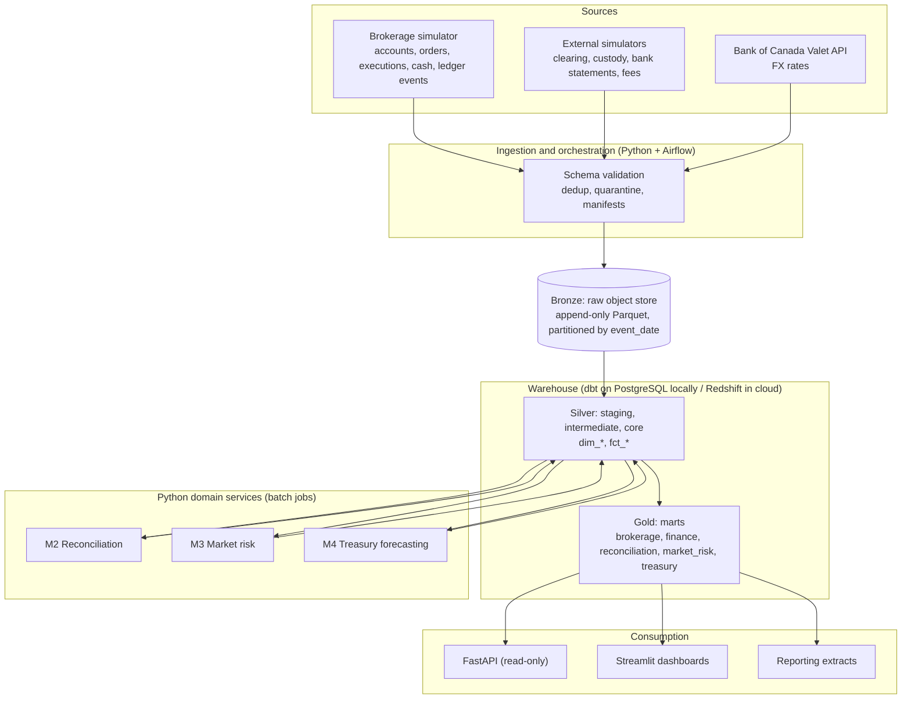

# System overview

| | |
|---|---|
| Status | Approved target architecture (2026-11-18). Partly built: the local stack, CI, and the Sprint 1 slice (`common`, `domain`, `simulation`, `infrastructure`, `application`; dbt staging, core, and one control mart). The roadmap tracks what exists. |
| Last updated | 2026-11-18 |
| Decisions | [ADR 001](../adr/001-platform-architecture.md), [ADR 003](../adr/003-batch-first-processing.md), [ADR 005](../adr/005-local-postgres-cloud-redshift.md), [ADR 007](../adr/007-single-owner-for-each-calculation.md), [ADR 008](../adr/008-data-lineage-and-observability.md), [ADR 009](../adr/009-local-telemetry-backend.md) |

## 1. Architecture at a glance



Python services read validated core models and write versioned results back to the warehouse. dbt then publishes those results through marts. Consumers read **only** marts.

## 2. Architectural principles

1. **The ledger comes first** ([ADR 002](../adr/002-ledger-system-of-record.md)). All balances derive from immutable journal lines.
2. **Batch comes first** ([ADR 003](../adr/003-batch-first-processing.md)). Daily calculations must be trustworthy before anything becomes event-driven.
3. **Reproducible.** Every result can be regenerated from a known input version, code version, and as-of date.
4. **Separation of concerns.** The warehouse owns trusted analytical data. Python owns quantitative models and stateful workflows. Interfaces only present results.
5. **Auditable.** Every result links back to source records, transformation versions, and the run that produced it.
6. **Pragmatic scope.** Build a working vertical slice first. Add complexity only where it demonstrates a capability the platform needs.

## 3. Layers and responsibilities

| Layer | Path (target) | Responsibility | Must not |
|---|---|---|---|
| Domain | `src/northstar/domain/` | Authoritative business calculations: posting rules, margin, matching, VaR | do I/O, read config files, or read the environment |
| Simulation | `src/northstar/simulation/` | Deterministic event generation and defect injection | read warehouse tables |
| Ingestion | `src/northstar/ingestion/` | Extraction, validation, dedup, checkpoints, quarantine | transform business meaning |
| Infrastructure | `src/northstar/infrastructure/` | Adapters: database, object storage, HTTP clients | contain business rules |
| Application | `src/northstar/application/` | Use cases wiring domain + infrastructure (e.g., `reconcile_trades`) | duplicate domain logic |
| Warehouse | `warehouse/dbt/` | Staging, core, and mart transformations; data tests | reimplement Python-owned models |
| ML | `ml/` | Forecast training, evaluation, inference | be imported by the domain layer |
| Orchestration | `orchestration/airflow/` | Scheduling and dependencies; tasks call the application layer | contain business logic |
| Services | `services/api/`, `services/dashboards/` | Read-only delivery of published marts | calculate metrics |
| Infrastructure as code | `infrastructure/terraform/` | AWS resources | be bypassed by console changes |

Dependency direction: `services/orchestration → application → domain`, and `application → infrastructure`. The domain layer depends on nothing in the project except `common/`.

## 4. Daily batch flow (target)

| Step | Job | Depends on | Output |
|---|---|---|---|
| 1 | Ingest brokerage, ledger, and external sources | — | raw objects + ingestion manifest |
| 2 | Ingest market prices and Bank of Canada FX | — | raw objects + manifest |
| 3 | dbt build: staging → core | 1, 2 | validated core models; integrity tests pass |
| 4 | Reconciliation run | 3 | match results, exceptions |
| 5 | Margin and portfolio risk run | 3 | margin exposure, risk results, alerts |
| 6 | Liquidity forecast run | 3 | forecasts with intervals |
| 7 | dbt build: marts | 4, 5, 6 | finance, risk, treasury, and control marts |
| 8 | Publication gate | 7 | snapshot `DRAFT → PUBLISHED`, or blocked with a reason |

If step 3's integrity tests fail, steps 4–8 do not run for that date.

## 5. Environments

| Environment | Compute and storage | Purpose |
|---|---|---|
| Local | Docker Compose: PostgreSQL, Airflow, an S3-compatible object store (SeaweedFS, chosen in Sprint 1; see roadmap), an OpenTelemetry Collector ([ADR 009](../adr/009-local-telemetry-backend.md)) | development, CI fixtures, demo |
| dev (AWS) | S3, Redshift Serverless, ECR, ECS Fargate, Secrets Manager, CloudWatch, IAM | cloud integration |
| prod (AWS) | same as dev, separate account or state | portfolio deployment |

Airflow runs locally at first. A managed orchestrator is deliberately deferred to control cost. AWS budget alerts are created before any other resource.

## 6. Storage layout

### Object storage

```
s3://northstar-data-{environment}/
├── raw/            {brokerage,accounting,clearing,custody,bank,market_data}/<entity>/event_date=YYYY-MM-DD/
├── quarantine/     {schema_errors,business_rule_failures}/
├── curated/        {finance,brokerage,market_risk,treasury}/
├── ml/             {training,evaluation,inference}/
├── reports/        {finance,risk,regulatory_simulation}/
└── audit/          {ingestion_manifests,processing_runs,publication_manifests}/
```

- Partition by date, never by high-cardinality IDs.
- Run IDs, schema versions, and checksums go in manifests and file metadata.
- Lifecycle, retention, encryption, and access policies are defined in Terraform.

### Repository `data/` folder

This folder holds only small sample datasets and fixtures. Generated datasets, warehouse dumps, and artifacts are never committed.

## 7. Repository layout (target)

This is the end state. Directories are created only when they contain real code (see [CONTRIBUTING.md, W1](../../CONTRIBUTING.md#working-rules)).

```
northstar-brokerage-intelligence/
├── .github/            workflows (CI, security scan, deploy), PR template
├── config/             non-secret settings + versioned policy YAML (accounting, brokerage, risk, forecasting)
├── contracts/          event JSON Schemas, warehouse contracts, OpenAPI spec
├── src/northstar/      common/, domain/, simulation/, ingestion/, infrastructure/, application/
├── warehouse/dbt/      created with `dbt init` — models/{sources,staging,intermediate,core,marts}, macros, snapshots, seeds, tests
├── orchestration/      airflow/{dags,task_groups,operators,sensors,callbacks,tests}
├── ml/                 forecasting/{datasets,models,training,evaluation,inference}, model_cards/, notebooks/ (exploration only)
├── services/           api/ (FastAPI), dashboards/ (Streamlit)
├── infrastructure/     docker/, terraform/{modules,environments}
├── monitoring/         data_quality/, model_monitoring/, operational/
├── tests/              unit/, integration/, financial_invariants/, quantitative_validation/, contract/, end_to_end/, performance/, fixtures/
├── scripts/            bootstrap, seed, generate, replay, backfill, benchmark
├── docs/               architecture/, adr/, business/, engineering/, project/, (later) data-governance/, quantitative-methods/, runbooks/, portfolio/
└── data/               samples only
```

### Module-to-folder ownership

| Module | Primary locations |
|---|---|
| M1 Data Foundation | `src/northstar/ingestion/`, `warehouse/dbt/`, `orchestration/` |
| M2 Financial Controls | `src/northstar/domain/accounting/`, `src/northstar/domain/reconciliation/`, `warehouse/dbt/models/marts/reconciliation/` |
| M3 Market Risk | `src/northstar/domain/market_risk/`, `config/risk/` |
| M4 Treasury | `src/northstar/domain/treasury/`, `ml/forecasting/` |
| M5 Finance | `src/northstar/domain/finance/`, `warehouse/dbt/models/marts/finance/` |

## 8. Cross-cutting concerns

| Concern | Approach |
|---|---|
| Lineage | OpenLineage job/run/dataset events for pipeline lineage; `_source_event_id`, `_ingestion_run_id`, `_dbt_invocation_id` on rows; run manifests in `audit/`; dbt docs lineage graph. OpenLineage backend is not yet selected ([ADR 008](../adr/008-data-lineage-and-observability.md)). |
| Data quality | schema validation at ingestion; dbt generic and singular tests; invariant tests (domain model §8) |
| Observability | OpenTelemetry traces, metrics, and logs; structured JSON logs carrying `run_id`; export to CloudWatch over OTLP in AWS. CloudWatch alarms and resources are managed in Terraform ([ADR 008](../adr/008-data-lineage-and-observability.md)). |
| Security | IAM least privilege; Secrets Manager; no secrets in Git ([SECURITY.md](../../SECURITY.md)) |
| Model governance | model cards, versioned models, backtests, and drift monitoring (written alongside the models) |
| CI/CD | GitHub Actions: lint, type-check, tests, dbt compile and test on fixtures, Terraform validate, dependency scan |
